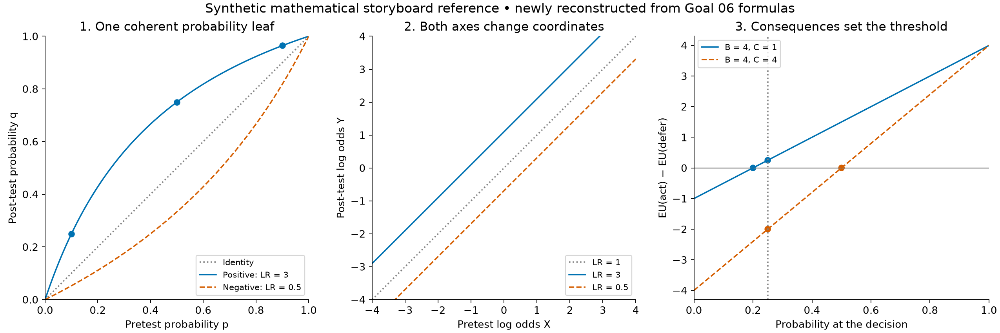

# Goal 06: Log odds for evidence, probability for consequences

## Deliverable and intent

Create a new narrated companion to the accepted 48-second clinical coordinate film. The viewer should leave able to distinguish two questions: **How should this finding change my belief? What action follows from that belief and its consequences?** A diagnostic leaf plot connects the existing probability, odds, and log-odds examples to an explicit decision.

**Visual reference:** The plate below is a mathematical storyboard reference, not a produced video frame. Present its panels sequentially in the actual film so the viewer can follow each relationship.



| Item | Requirement |
|---|---|
| Default deliverable | One complete narrated companion film |
| Nominal duration | 180 seconds; permit 162–198 seconds after measured speech timing |
| Closing hold | At least 7 seconds of completed, stationary geometry; brief closing narration followed by silence |
| Scene | `animations/scenes/clinical_beliefs_actions.py`, class `ClinicalBeliefsActions` |
| Slug | `06_beliefs_actions_clinical_v1` |
| Scientific story / clinical cues | `animations/core/story06.py` / `animations/core/story06_clinical.py` |
| Reference data | `animations/data/beliefs_actions_fixtures.json`, key `goal_06` |
| Optional adaptation | A 60-second continuation, outlined below, only if separately requested |

Read [the repository style audit](00_repository_style_audit.md), current `AGENTS.md`, `animations/README.md`, and production handoff before implementation. The audit identifies the inspected video branch and production constraints. Preserve all existing films, fixtures, narration, and review records. This goal specifies implementation work; it does not report a rendered or reviewed film.

**Repository connection:** [`display_reasoning.ipynb`](https://github.com/reblocke/notebooks_dx_reasoning/blob/5e924fbcf6e5af4c2eb3c6be0000499489bedfcc/display_reasoning.ipynb) already defines `leaf_plot`, `odds_leaf_plot`, and `log_odds_leaf_plot`. Extend their visual argument with explicit animation helpers; do not execute the notebook to render the film. Its families of hypothetical finding strengths are not automatically paired outcomes of a single test. Here the specified sensitivity and specificity produce the coherent pair LR+ = 3 and LR− = 0.5. Also, odds on logarithmic axes and log odds on linear axes represent equivalent geometry up to log-base scaling, not successive evidence updates.

### Three takeaways

1. A fixed likelihood ratio produces a curved prior-to-posterior relationship on probability axes. Express **both axes** as log odds and the relationship becomes a straight line with slope one.
2. Log odds make evidence accumulation additive. Each new increment must use the likelihood ratio conditional on what has already been observed.
3. Probabilities make expected consequences a weighted sum. Utilities determine the action threshold. Probability, odds, and log odds give the same decision when transformed consistently.

The title describes useful mathematical representations, not exclusive roles. Probability also supports evidence updating; decisions can also be calculated in log odds. Neither representation is universally best for every task.

## Scientific contract and exact fixtures

All performance values, priors, and utilities are synthetic. Continue the current clinical frame, pneumonia versus no pneumonia, with a persistent `TOY MODEL • ILLUSTRATIVE VALUES` footer. These are binary exhaustive states. No named clinical test or actual treatment recommendation is implied.

### 1. One specified test makes the leaf

Let $D$ denote pneumonia and $E_+$, $E_-$ the two mutually exclusive results of one hypothetical test. Hold its state-conditional performance fixed while varying the prior:

$$
P(E_+\mid D)=\mathrm{Se}=\frac35,\qquad
P(E_-\mid\neg D)=\mathrm{Sp}=\frac45.
$$

$$
LR_+=\frac{3/5}{1/5}=3,\qquad
LR_-=\frac{2/5}{4/5}=\frac12.
$$

For prior $p=P(D)$, the posterior after a result with likelihood ratio $R$ is

$$
q=f_R(p)=\frac{Rp}{1-p+Rp}.
$$

The probability leaf has horizontal axis **pretest probability $p$** and vertical axis **post-test probability $q$**, both from zero to one. Draw the identity $q=p$, the positive-result curve $f_3(p)=3p/(1+2p)$, and the negative-result curve $f_{1/2}(p)=p/(2-p)$. Starting at $(p,p)$, a vertical guide reaches the appropriate curve; a horizontal guide reads the posterior on the vertical axis. This is the diagnostic leaf construction described by Coulthard and Coulthard.[1]

The negative-result curve belongs to this same test. Its LR is $1/2$, not $1/3$. The reciprocal $1/3$ in the earlier coordinate film reverses the positive update mathematically; it is not this test's negative-result LR. Keep result labels explicit. Do not shade the leaf as if its area measured information, clinical benefit, or test value.

| Example | Prior $p$ | Positive posterior $q_+$ | Negative posterior $q_-$ | Positive probability change |
|---|---:|---:|---:|---:|
| Patient 1 | $1/10$ | $1/4=25\%$ | $1/19\approx5.26\%$ | $3/20=0.15$ probability units = 15 percentage points |
| Patient 2 | $1/2$ | $3/4=75\%$ | $1/3\approx33.33\%$ | $1/4=0.25$ probability units = 25 percentage points |
| Patient 3 | $9/10$ | $27/28\approx96.43\%$ | $9/11\approx81.82\%$ | $9/140\approx0.0643$ probability units ≈ 6.43 percentage points |

These are three hypothetical starting beliefs, not simultaneous hypotheses or a longitudinal patient cohort. They reproduce the earlier positive endpoints exactly.

### 2. Change both axes, then add a new finding

Use natural logarithms throughout:

$$
X=\operatorname{logit}(p)=\ln\frac{p}{1-p},\qquad
Y=\operatorname{logit}(q),\qquad Y=X+\ln R.
$$

The identity becomes $Y=X$. The result curves become parallel lines $Y=X+\ln3$ and $Y=X-\ln2$. Their offsets are respectively $1.0986122886681098$ and $-0.6931471805599453$, in natural-log units. This is a coordinate change, with no additional evidence. Good's weight-of-evidence account supplies the log-likelihood-ratio interpretation.[2]

| Prior log odds | Positive log odds | Negative log odds |
|---:|---:|---:|
| $-\ln9$ | $-\ln3$ | $-\ln18$ |
| $0$ | $\ln3$ | $-\ln2$ |
| $\ln9$ | $\ln27$ | $\ln(9/2)$ |

Use equal physical units on both axes, with a fixed finite window such as $[-4,4]$ for each. Clip lines at the window, visibly implying continuation. Zero and one map to infinite log odds and must not appear at finite logit endpoints. Fade to the new validated axes; a nonlinear morph is unnecessary.

For the short sequence, introduce a **distinct new finding $E_2$** after the first positive result $E_1$. Set $P(E_2\mid D,E_1)=4/5$ and $P(E_2\mid\neg D,E_1)=2/5$, giving conditional LR $2$. Then

$$
\frac1{10}\xrightarrow{LR_1=3}\frac14
\xrightarrow{LR(E_2\mid E_1)=2}\frac25,
\qquad
\frac19\rightarrow\frac13\rightarrow\frac23
\quad\text{in odds}.
$$

The log-odds increments are $\ln3$, then $\ln2$. In general,

$$
LR_t=\frac{P(E_t\mid D,E_{<t})}{P(E_t\mid\neg D,E_{<t})},\qquad
\operatorname{logit}(p_t)=\operatorname{logit}(p_{t-1})+\ln LR_t.
$$

The addition is exact. Reusing standalone finding LRs requires appropriate conditional-independence assumptions. The second finding is not the negative outcome of the first test. Show this sequence separately from the fixed positive/negative leaf, with the caption `New finding • LR conditional on the first result`.

### 3. Consequences determine the action threshold

Compare two abstract actions, **act** and **defer**. Define the state-conditional incremental utility of acting compared with deferring as $+B$ when $D$ is present and $-C$ when it is absent. Both $B$ and $C$ are positive magnitudes in the same arbitrary utility units, already incorporating the relevant within-state consequences.

The expected utility difference at disease probability $p$ is

$$
G(p)=EU(\mathrm{act}\mid p)-EU(\mathrm{defer}\mid p)
=pB-(1-p)C.
$$

Choose act for $G>0$, defer for $G<0$, and show indifference at zero. Consequently,

$$
p^*=\frac{C}{B+C},\qquad O^*=\frac CB,\qquad
X^*=\ln\frac CB.
$$

This threshold follows expected-utility reasoning, also developed in Vickers and Elkin's decision-curve paper.[3] Our plot is a single-decision expected-utility difference, not a population decision curve or net-benefit analysis.

For $B=4,C=1$, display $G(p)=5p-1$. The threshold is $p^*=1/5$, odds $1/4$, and log odds $-\ln4=-1.3862943611198906$. On this panel, the horizontal coordinate is the probability available at the decision; evaluate the same function at a prior $p$ or posterior $q$.

| Belief before → positive result | $G(p)\rightarrow G(q_+)$ | Change in estimated utility difference |
|---|---:|---:|
| $1/10\rightarrow1/4$ | $-1/2\rightarrow1/4$ | $3/4$ |
| $1/2\rightarrow3/4$ | $3/2\rightarrow11/4$ | $5/4$ |
| $9/10\rightarrow27/28$ | $7/2\rightarrow107/28$ | $9/28\approx0.32143$ |

Only Patient 1 crosses the action threshold after the positive result. Its negative posterior $1/19$ remains below the threshold, with $G=-14/19$. Equal log-odds increments can therefore produce different probability changes and different revisions to the estimated utility of an action. These revisions are not causal health gains or the expected value of testing. The latter requires averaging optimized decisions across possible outcomes and accounting for test costs, outside this film's scope.

Finally hold $q=1/4$ fixed, retain $B=4$, and change $C$ from one to four. The utility line changes from $5p-1$ to $8p-4$; the threshold moves from $1/5$ to $1/2$, and $G(1/4)$ changes from $1/4$ to $-2$. Belief has not changed. Consequences have changed the preferred action.

With $\sigma(X)=1/(1+e^{-X})$, the same decision can be written

$$
G(\sigma(X))=(B+C)\sigma(X)-C,\qquad
p>p^*\iff O>C/B\iff X>\ln(C/B).
$$

Probabilities directly weight the state-conditional utilities. In this binary model, the utility difference is affine in $p$, meaning a straight line that need not pass through the origin. Log odds make fixed-LR updating additive. Reparameterization changes neither expected utility nor the preferred action.

## Storyboard and narration

The twelve contiguous cues C01–C12 below total 180 seconds. Captions are short burned-in text; narration is a suggested complete script, editable for pronunciation and measured timing without changing claims. Mathematical labels and meaningful captions must carry the argument with sound off. Use one main plot at a time, not a permanent dashboard. C12 starts the completed stationary hold, with a short closing sentence followed by silence.

### C01, 0–10 s: Two questions

**Screen and motion:** Reuse the three positive endpoints from the coordinate film as a compact opening card. Let `What changed in belief?` become `What changes the action?` with a sequential fade.

**Caption:** `Evidence changes belief. Consequences guide action.`

**Narration:** “The same evidence shifts log odds equally. But what does that mean for a patient's probability, and for the next decision?”

### C02, 10–25 s: Build the leaf

**Screen and motion:** Establish square probability axes and the identity diagonal. Label pretest and post-test probabilities. Add the two result curves and a small fixed-model card: sensitivity 60%, specificity 80%, positive LR 3, negative LR 0.5.

**Caption:** `A leaf plot maps each prior to two possible posteriors.`

**Narration:** “A leaf plot places the starting probability on the horizontal axis and the updated probability on the vertical. This hypothetical test has one curve for a positive result and another for a negative result.”

### C03, 25–43 s: Read the result

**Screen and motion:** Hold at the 10% diagonal point, trace to 25%, then reset and trace to 5.26%. Briefly mark the other two positive endpoints, labeled Patient 2 and Patient 3. Read one example at a time; retain endpoint cards after guides fade.

**Caption:** `10% → 25% if positive; 10% → 5.26% if negative.`

**Narration:** “Start on the diagonal at ten percent. A positive result takes us to twenty-five percent; a negative result takes us to about five percent. Here, the negative likelihood ratio is one half. It is not the reciprocal of three.”

### C04, 43–60 s: Change both coordinates

**Screen and motion:** Fade out probability ticks and curves, then reveal logit axes and parallel lines. Preserve the three example identities. Show equal vertical positive offsets against the identity, and the smaller negative offset below it. Reveal `Y = X + ln LR` after the axes settle.

**Caption:** `Both axes in log odds: the curves become parallel lines.`

**Narration:** “Now express both axes as log odds. No new evidence has arrived. Each curve becomes a straight line: the starting log odds plus the log likelihood ratio. Every positive result adds the same amount.”

### C05, 60–77 s: A distinct second finding

**Screen and motion:** Replace the leaf with a compact log-odds ruler. Show two consecutive arrows, lengths proportional to ln 3 and ln 2. Underneath, reveal the probability trail 10% → 25% → 40%. Label the second finding's conditional likelihoods 0.8 and 0.4.

**Caption:** `Add evidence using the LR conditional on earlier findings.`

**Narration:** “A different finding now has a likelihood ratio of two, conditional on that first result. Add its log likelihood ratio and the probability becomes forty percent. Dependent findings need these conditional ratios, not automatic reuse of standalone values.”

### C06, 77–95 s: Introduce consequences

**Screen and motion:** Clear evidence objects. Show a two-state utility card: disease present, act versus defer +4; disease absent, act versus defer −1. Build the weighted expression, then the line $G(p)=5p-1$ with probability horizontally and utility difference vertically.

**Caption:** `Expected utility difference = p × 4 − (1 − p) × 1.`

**Narration:** “For the decision, suppose acting rather than deferring is worth four utility units when disease is present and costs one when it is absent. Probabilities weight those consequences. The result is the expected utility difference between the two actions.”

### C07, 95–112 s: Cross the threshold

**Screen and motion:** Highlight the utility line's zero at 20%. Reintroduce Patient 1 at 10%, move to the positive posterior 25%, and switch the preference label from defer to act. A smaller negative-result marker at 5.26% remains below threshold. Label the threshold as illustrative.

**Caption:** `With these consequences, act above 20%; defer below.`

**Narration:** “The actions tie at twenty percent. Below that threshold, deferring has greater expected utility; above it, acting does. Our ten-percent patient crosses the threshold after a positive result. A negative result stays below it.”

### C08, 112–132 s: Equal evidence, unequal consequence estimates

**Screen and motion:** On fixed probability and utility axes, highlight the three positive updates in sequence. Place three compact rows beside the plot: ΔG +0.75, +1.25, and approximately +0.32. Keep the common ln 3 tag visible. Never rescale each arrow independently.

**Caption:** `Same log-odds increment. Different changes in expected utility.`

**Narration:** “The three starting probabilities receive exactly the same log-odds increment. Yet their estimated utility differences change by different amounts. Only the first changes the preferred action. These are revisions to an estimate, not health gains caused by observing the test.”

### C09, 132–150 s: Change the stakes, hold belief fixed

**Screen and motion:** Keep the posterior's horizontal coordinate at 25%. Change only the cost card from one to four. Move the utility line and its zero together: threshold 20% → 50%, utility at 25% from +0.25 to −2. End with the probability marker visibly unmoved.

**Caption:** `Same 25% probability. Different consequences, different action.`

**Narration:** “Keep the probability at twenty-five percent, but increase the cost of acting without disease from one utility unit to four. The threshold moves to fifty percent. The preferred action changes because the consequences changed, not because the evidence changed.”

### C10, 150–166 s: The decision survives a coordinate change

**Screen and motion:** Reset the utility card explicitly to B=4, C=1. Present one probability ruler with 25% and threshold 20%, then fade to a log-odds ruler with −ln 3 and threshold −ln 4. The marker stays on the act side. Show equivalent inequalities, not two new evidence arrows.

**Caption:** `20% ↔ odds 1:4 ↔ log odds −ln 4. Same decision.`

**Narration:** “Return to the original consequences. The twenty-percent threshold is equally an odds threshold of one to four, or a log-odds threshold of minus log four. Changing coordinates preserves the expected utility and the decision.”

### C11, 166–173 s: Complete the recap

**Screen and motion:** Settle before 173 seconds into two concise cards: `Evidence: log odds add ln LR` and `Consequences: probabilities weight utilities`. A shared footer says `Transform consistently: the decision is unchanged.` Finish all caption fades and narration before C12 starts.

**Caption:** `Evidence updates belief. Consequences set the threshold.`

**Narration:** “Log odds add evidence. Probabilities weight consequences.”

### C12, 173–180 s: Completed closing hold

**Screen and motion:** Hold the completed C11 composition for seven seconds. All onscreen words and geometry are already settled. No entry fade, motion, blinking cursor, or changing number. Deliver the closing sentence early, then leave silence. Keep the final frame complete.

**Caption:** `Evidence updates belief. Consequences set the threshold.` Already fully visible at 173 seconds.

**Narration:** “Either scale gives the same decision.”

## Manim implementation and review

Reuse the current `Cue` structure, clinical palette, Arial, short caption zone, and sequential fades. Use disease blue and no-disease gray consistently; patient rows are numbered, not diagnostic colors. Distinguish positive and negative curves by explicit labels plus line style, not color alone. Keep plots large enough that 10%, 20%, and 25% markers remain distinguishable at 720p playback. External labels and leaders may clarify nearby marks; geometry must remain truthful.

Implement pure leaf mappings and utility calculations in small focused helpers such as `core/leaf_plots.py` and `core/decision_math.py`. Reuse existing validated binary arithmetic where appropriate. Store exact fractions or their numerator/denominator pairs, formula-derived full-precision values, labels, and utility assumptions under `goal_06` in `data/beliefs_actions_fixtures.json`. Do not compute from rounded display percentages. Preserve `data/manim_fixtures.json`. Keep this film's fixture separate from goal 05 so adding either film cannot silently change the other's approved input identity.

Extend the existing renderer's explicit registry, clinical timing, events, keyframes, source dependencies, and finalizer to support 06. The current runner supports 01–04; `--goal 06 --cut clinical` is an interface to implement. Goal 06 must select this narrated clinical film by default; preserve old goals' default behavior and reject explicitly supplied unsupported cuts. Both the default and explicit clinical route must select the same scene and slug. Register the new fixture's actual hash and include it, both story modules, helpers, scene, and audio inputs in the frozen producer snapshot. Do not associate this film with the unrelated legacy fixture hash. See the shared audit for integration points.

Preserve the existing nonempty-narration `Cue` contract for all twelve cues. C12 contains the short closing sentence, and its start identifies the actual stationary hold. No silent-cue infrastructure is needed. Complete the final caption before C12 begins; its speech-aligned subtitles may appear while the authored composition remains stationary.

Use Samantha at 160 words per minute and the established local narration path. Measure every speech interval; word count is only a planning aid. Retiming may use the permitted duration range, while preserving contiguous cues and the stationary closing hold. If a mathematical expression sounds awkward, use the written-out phrase in narration while preserving the equation onscreen. Generate editable narration text and speech-aligned SRT/VTT from the same cue source. Captions are short explanatory text; subtitles transcribe the actual narration.

### Focused acceptance checks

- Verify both LRs from sensitivity and specificity; all six posterior fractions; the three positive logit offsets; and the sequential 10% → 25% → 40% example. Compare unrounded values with absolute tolerance $10^{-10}$.
- Verify all utility-table entries, both thresholds, and $G(1/4)=-2$ under $B=C=4$. Confirm probability, odds, and logit criteria agree below, at, and above each threshold; equality means indifference.
- Confirm probability curves have correct endpoints and stay inside the unit square. Confirm logit geometry uses finite interior probabilities, two transformed axes, equal axis units, slope-one lines, and correctly clipped boundaries.
- Verify that changing coordinates changes no posterior; changing C changes no belief; the second finding is labeled conditional and distinct. No intermediate animation state may pair a moving value with a contradictory endpoint label.
- Validate twelve contiguous cues with nonempty narration, measured speech fit, C12's completed stationary hold, actual video-frame duration, matching preview/final producer inputs, correct fixture identity, and isolated source-snapshot execution. Check goal 06's narrated default, rejection of unsupported cuts, and unchanged legacy defaults. Retain relevant existing regression gates.

Review keyframes around 24, 31, 41, 59, 76, 94, 111, 131, 149, 165, and 173 seconds, plus the final decoded frame just before the endpoint. Select it from actual decoded timestamps, not a nonexistent frame at 180 seconds; nominally it is near 179.967 seconds at 30 fps or 179.933 seconds at 15 fps. Adjust samples to actual retiming. Include frames before, during, and after coordinate fades, each threshold change, and the final hold. Frames cannot establish pacing or listening quality.

Render and inspect the complete corrected preview before launching the final. Follow current storage safeguards and sequential rendering. Review native 1080p and 720p playback, full sound, numerical pronunciation, text collisions, guide readability, and subtitle timing. Preserve strict version-3 decode/provenance receipts. Deliver final H.264/AAC MP4, preview, narration WAV/script, SRT/VTT, actual timing, keyframes/contact sheet, QA report, bound source snapshot, and manifest through the established output location. Record unavailable listening or playback honestly; do not report pending review as completion.

## Optional 60-second extension

This is an alternate editorial outline, not another commissioned render. If requested later, append or pair it with the existing coordinate film while retaining the main mathematical qualifications.

| Time | Content |
|---|---|
| 0–5 s | Recall the common positive LR of three |
| 5–20 s | Build the probability leaf and read the 10% positive/negative endpoints |
| 20–30 s | Re-express both axes as log odds; reveal parallel result lines |
| 30–44 s | Introduce B=4, C=1 and the 20% action threshold; show 10% → 25% crossing |
| 44–53 s | Hold 25% fixed, raise C to four, and move the threshold to 50%; state the recap |
| 53–60 s | Completed stationary closing hold; short closing sentence followed by silence |

Omit the second-finding sequence and three-row utility comparison from this short version. Preserve the negative-LR distinction, synthetic label, probability-versus-consequence separation, and coordinate invariance. Do not speed up the full script to fit.

## Copy-ready autonomous implementation prompt

```text
Implement and complete Goal 06 from
docs/manim/new_video_goals_20261101/06_log_odds_for_evidence_probability_for_consequences.md.
Read its sibling 00_repository_style_audit.md, AGENTS.md, animations/README.md,
and the current production handoff. Preserve accepted films and unrelated work.

Create ClinicalBeliefsActions with slug 06_beliefs_actions_clinical_v1:
180 seconds nominal, ±10%, twelve cues, and a completed stationary final hold of
at least seven seconds. Reuse the clinical style, Cue, and Samantha at 160 wpm.
Preserve the exact leaf, conditional-LR, expected-utility, and threshold claims.
Store goal_06 in animations/data/beliefs_actions_fixtures.json, separately from
other films. Add the specified story modules, scene, and focused math helpers.

Extend existing routing, timing, source provenance, and fixture-aware finalization.
Goal 06 is narrated by default; reject unsupported explicit cuts and preserve
old defaults. Preserve the existing nonempty-narration Cue contract: C12 starts
the stationary hold, speaks its short closing sentence, and ends in silence.
Run focused math, geometry, routing, timing/audio, and provenance checks.
Measure speech, synchronize timing, retain the storage guard, render sequentially.

After implementing the new route, run from the checkout root:
animations/.venv/bin/python animations/render.py --goal 06 --cut clinical --quality preview
animations/.venv/bin/python animations/scripts/review_video.py --slug 06_beliefs_actions_clinical_v1 --quality preview

Inspect the entire preview with sound and required keyframes; correct defects.
Then run:
animations/.venv/bin/python animations/render.py --goal 06 --cut clinical --quality final
animations/.venv/bin/python animations/scripts/review_video.py --slug 06_beliefs_actions_clinical_v1 --quality final

Review final playback and listening, then use the extended existing finalizer
with slug 06_beliefs_actions_clinical_v1, scene clinical_beliefs_actions.py, and
an actual review note. Retain all required movies, audio, sidecars, fixtures,
verification evidence, QA, manifest, and producer snapshots. Do not invent passes.
Report exact artifacts, actual runtime, checks, and remaining resource/review
blockers. Complete authorized work; do not render the optional 60-second cut,
publish, overwrite accepted artifacts, or introduce a new production pipeline.
```

## Primary references

1. Coulthard MG, Coulthard T. [The leaf plot: a novel way of presenting the value of tests](https://pmc.ncbi.nlm.nih.gov/articles/PMC6428474/). *British Journal of General Practice*. 2019;69(681):205–206. doi:10.3399/bjgp19X702113. Supports the diagnostic leaf construction; no claim about information or utility follows merely from enclosed area.
2. Good IJ. [Weight of Evidence: A Brief Survey](https://www.cs.tufts.edu/~nr/cs257/archive/jack-good/weight-of-evidence.pdf). In *Bayesian Statistics 2*. 1985:249–270. Supports log likelihood ratios as additive weight of evidence, with conditional structure respected.
3. Vickers AJ, Elkin EB. [Decision curve analysis: a novel method for evaluating prediction models](https://pmc.ncbi.nlm.nih.gov/articles/PMC2577036/). *Medical Decision Making*. 2006;26(6):565–574. doi:10.1177/0272989X06295361. Supports the connection between threshold odds and relative consequences; the film's utility examples are newly constructed synthetic calculations.
